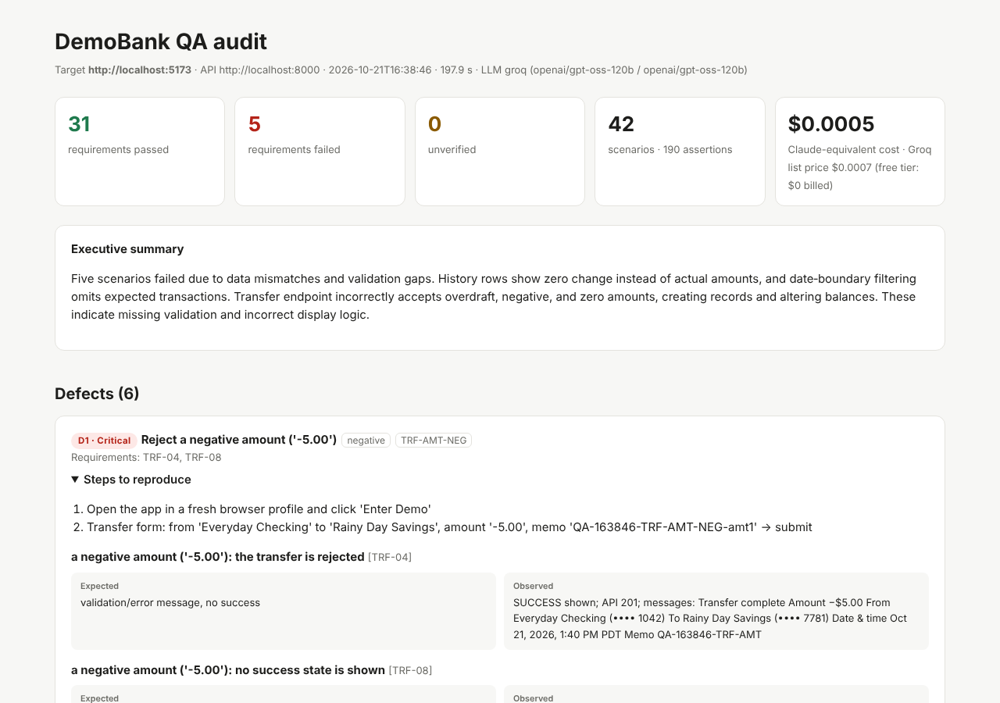
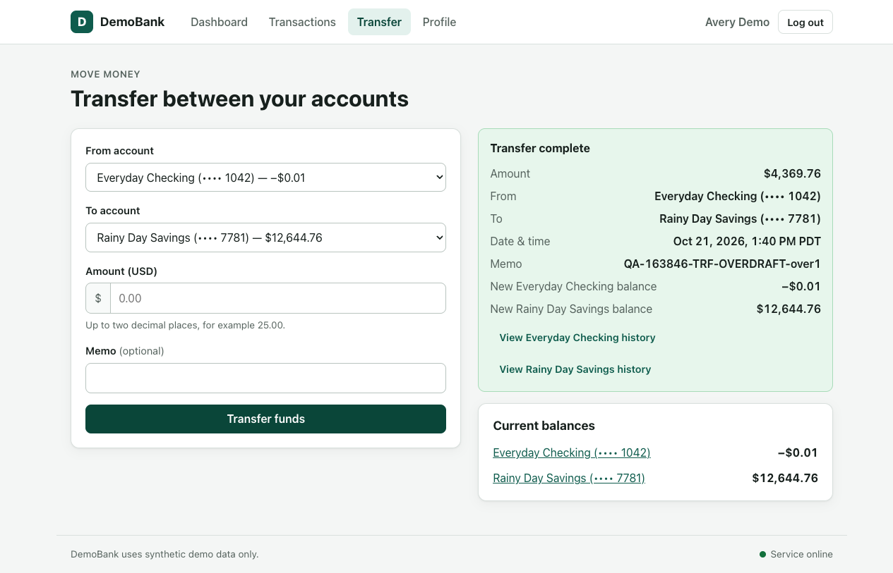
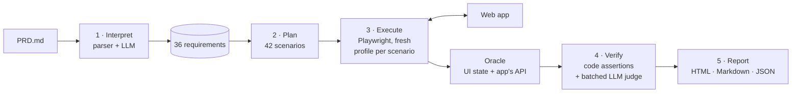

# Spec-driven AI QA agent

An autonomous QA agent that **reads a product spec, tests a web app in a real browser, and reports
whether the app actually does what the spec says**, with evidence for every verdict.

Built for the **CDF Agentic QA Hackathon** (October 2026), where the target was *DemoBank*, a fictional
banking app with synthetic data and deliberately hidden defects.



---

## The idea in one picture

A green **"Transfer complete"** message is not proof that a requirement passed:



The spec says transfers must not exceed the available balance. Here, $4,369.76 was moved out of an
account holding $4,369.75. The UI reports success **and** the balance is now **−$0.01**. A test that
only checks "the click worked" would pass this. This agent checks what *actually changed*.

---

## What it does

1. **Interprets** the spec (`PRD.md`) into 36 numbered, testable requirements (e.g. `TRF-04`).
2. **Plans** 42 scenarios: 17 normal, 12 negative, 13 edge cases.
3. **Executes** them in Chromium via Playwright, like a user: clicking, typing, filtering.
4. **Verifies** side effects, not messages: balances before and after, records in both account
   histories, persistence after refresh, and the app's own API responses.
5. **Reports** passed / failed / unverified for every requirement, with severity, reproduction steps,
   expected-vs-observed values, screenshots and a cost breakdown.

## Results on DemoBank

From a full run on a local copy of the app (21 Oct 2026, 3 min 18 s):

| | |
|---|---|
| Requirements | **31 passed · 5 failed · 0 unverified** |
| Scenarios / assertions | 42 / 190 |
| Defects | **6** (4 Critical, 2 Medium) |

| Severity | Defect |
|---|---|
| Critical | Overdraft allowed: balance + $0.01 is accepted, leaving the account at **−$0.01** |
| Critical | Negative amount (`-5.00`) accepted: money moves in reverse and "Transfer complete" is shown |
| Critical | Zero amount (`0`) accepted: a $0.00 "completed" transfer record is created |
| Critical | Zero amount (`0.00`) accepted, same as above |
| Medium | Date filter: transactions **on** the end date are missing (start date works) |
| Medium | Pending/failed rows show **$0.00** instead of their amount (e.g. a $700 failed deposit) |

Full report: [`sample-report/report.md`](sample-report/report.md) ·
interactive HTML: [`sample-report/report.html`](sample-report/report.html) (download and open) ·
PDF: [`docs/QA-Audit-Report.pdf`](docs/QA-Audit-Report.pdf)

---

## How it works



### Design decisions

- **Verify side effects, not messages.** Each transfer is checked with a before/after snapshot:
  exact balance deltas, exactly one record in both account histories, and survival after a refresh.
- **Use AI only where judgement is needed.** Navigation, clicking and assertions are deterministic code.
  The LLM does four jobs: decompose the spec, judge whether error messages are *clear* (in one batched
  call), heal a broken locator, and write the summary. Results are reproducible, and a run costs cents.
- **Honest verdicts.** If nothing reliable could be observed, the requirement is **unverified**, never a
  silent pass. Unexpected changes made by other users mark checks unverified instead of failing them.
- **Resilience.** Semantic locators (role/label/text) with fallbacks and LLM healing; waits for the page
  to *stop changing* rather than fixed sleeps; safe retries that never repeat a money-moving action.
  A `--chaos` mode renames UI labels mid-run to prove verdicts don't depend on exact wording.
- **Test hygiene.** Every test transfer uses a unique memo, and balance drift is reversed after each
  scenario with a clearly labelled compensating transfer.

More detail, including the bugs found *in the agent itself* and how they were fixed:
[`DESIGN_NOTES.md`](DESIGN_NOTES.md).

---

## Cost

| | LLM calls | Cost (Groq, free tier) | Same tokens on Claude* |
|---|---|---|---|
| First run (spec analysis fresh) | 3 | $0.0025 list price · $0 billed | ≈ $0.03 |
| Repeat run (spec analysis cached) | 2 | $0.0007 list price · $0 billed | ≈ $0.0005 |

\* Claude Haiku 5.5 / Sonnet 5.5 list prices applied to the same token counts. Different model families
count tokens differently, so treat this column as an estimate. Every report itemises calls, tokens and
cost per purpose.

---

## Quick start

Requires Python 3.11+ and a running copy of the target app (see [GETTING_STARTED.md](GETTING_STARTED.md)).

```bash
python -m venv .venv && source .venv/bin/activate      # Windows: .venv\Scripts\Activate.ps1
pip install -r requirements.txt
python -m playwright install chromium
cp .env.example .env                                   # add GROQ_API_KEY=... or ANTHROPIC_API_KEY=...
python -m qa_agent --check-llm                         # optional: test the key
python -m qa_agent --url http://localhost:5173 --prd path/to/PRD.md --headed
```

No API key? Add `--offline`: every AI step falls back to a deterministic rule, and the report estimates
what the AI calls would have cost.

Useful flags: `--headed` (watch the browser) · `--only transfers` (one suite) · `--chaos` (resilience
demo) · `--api-url` (if the app's API can't be discovered automatically).

## Project structure

```
qa_agent/
  __main__.py   command-line entry point (+ --check-llm)
  runner.py     runs the loop: interpret → plan → execute → verify → report
  prd.py        spec → numbered requirements (+ optional LLM enrichment)
  browser.py    Playwright driver: self-healing locators, settle waits, evidence capture
  flows.py      reusable user flows (enter demo, transfer, filters) and state readers
  harness.py    scenario registry and per-scenario context
  suites/       the 42 scenarios: session, accounts, history, transfers, profile & UI
  judge.py      batched message-clarity judge + executive summary
  llm.py        Groq / Claude client with cost ledger, caching and model auto-selection
  models.py     requirement / scenario / assertion model and verdict roll-up
  report.py     HTML, Markdown and JSON reports with severity triage
tests/          unit tests (no browser, API key or app needed): python -m pytest -q
sample-report/  the full report from the run above
docs/           PDF export of the report and README images
```

---

## Notes

- **The target app is not included.** DemoBank and its spec belong to the hackathon organisers. Run this
  agent against your copy of the hackathon kit, or adapt the suites to another app.
- **Synthetic data only.** All names, balances and account numbers in the report are fake.
- **AI-assisted development.** Built with Claude as an AI pair programmer. I set the direction, ran and
  debugged it on a real machine, and verified every reported defect against the evidence.
- **Limitations.** Message-clarity verdicts are subjective (an LLM judge, with a keyword fallback
  offline). The suites are written for DemoBank's domain: the architecture is general, but the scenarios
  are app-specific.

## License

[MIT](LICENSE)
